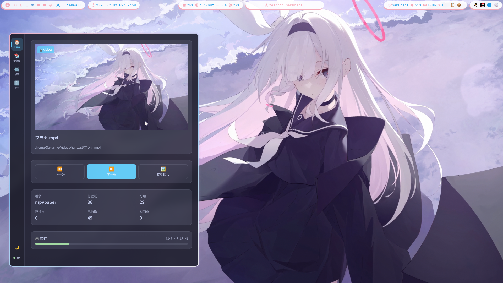
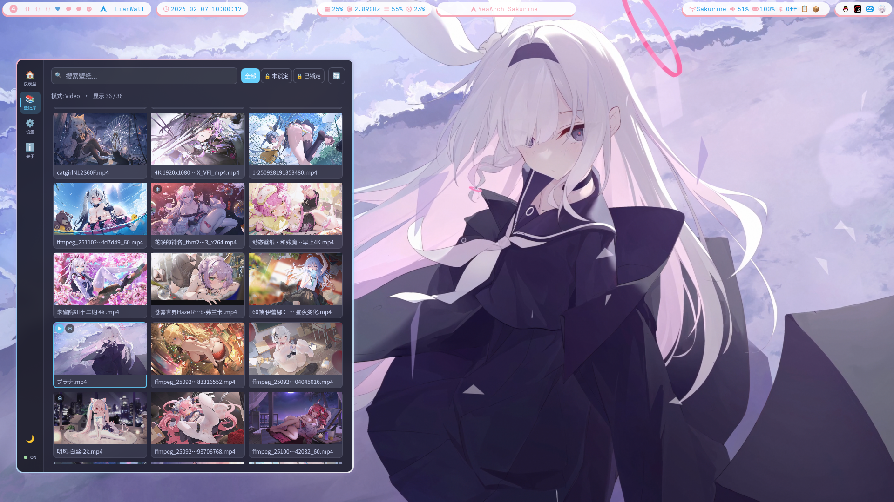
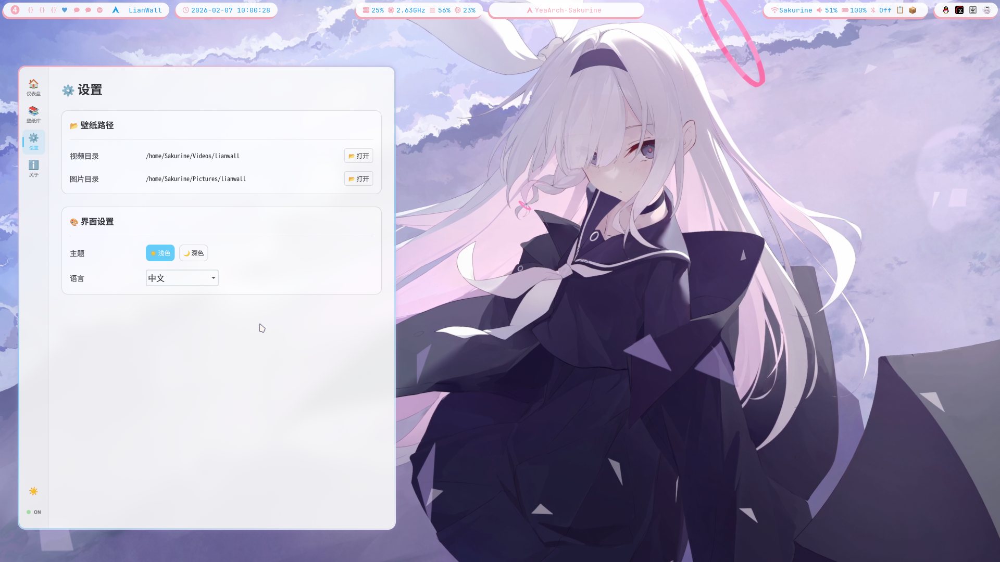
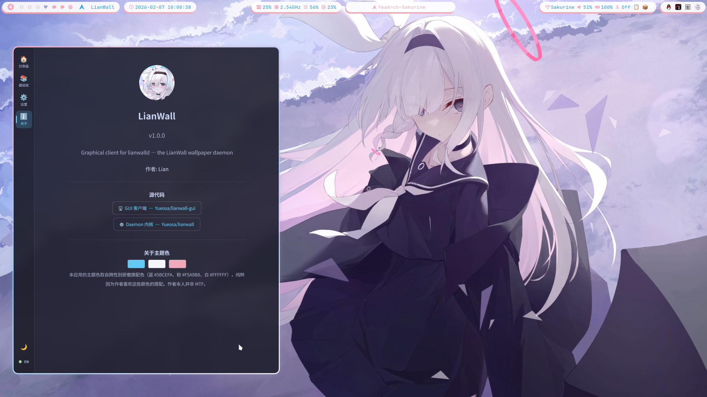

<div align="center">

# 🖼️ LianWall GUI

Qt6/QML 图形前端 — [lianwall](https://github.com/Yueosa/lianwall) 动态壁纸管理器的控制面板

[](https://github.com/Yueosa/lianwall-gui/releases)
[](LICENSE)
[](https://wayland.freedesktop.org/)
[](https://www.qt.io/)

</div>

> **lianwalld 守护进程的图形化客户端** 🎯
> - 通过 **Unix Socket** 直连 daemon，实时事件驱动
> - **仪表盘** — 当前壁纸预览、快捷操作、显存监控
> - **壁纸库** — 网格浏览、缩略图预览
> - **设置** — 主题切换、语言切换、VRAM 自定义后端配置
> - **系统托盘** — 后台驻留，关闭窗口 ≠ 退出
> - **中/英双语** — 运行时切换，即时生效

**关于版本更新日志，请查看 [CHANGELOG](./CHANGELOG.md)**

---

## 📸 界面预览

| 仪表盘 | 壁纸库 |
|:------:|:------:|
|  |  |

| 设置 | 关于 |
|:----:|:----:|
|  |  |

---

## 📦 安装

### Arch Linux (AUR)

```bash
# 使用 AUR helper
paru -S lianwall-gui
# 或
yay -S lianwall-gui
```

### 手动编译

```bash
git clone https://github.com/Yueosa/lianwall-gui.git
cd lianwall-gui

cmake -B build -DCMAKE_BUILD_TYPE=Release
cmake --build build

# 安装（可选）
sudo cmake --install build
```

### 依赖

#### 运行依赖

| 包 | 说明 |
|----|------|
| Qt 6 (Core, Gui, Widgets, Quick, QuickControls2, Network) | GUI 框架 |
| ffmpeg | 视频缩略图提取 |
| [lianwall](https://github.com/Yueosa/lianwall) ≥ 5.5.1 | 守护进程 (lianwalld) |

#### 编译依赖

| 包 | 说明 |
|----|------|
| CMake ≥ 3.16 | 构建系统 |
| Qt6 开发包 | 含 LinguistTools |
| C++17 编译器 | GCC ≥ 9 / Clang ≥ 10 |

---

## 🚀 使用

```bash
# 直接运行
lianwall-gui

# 或从编译目录
./build/lianwall-gui
```

启动后 GUI 会自动连接 `lianwalld` 守护进程。如果 daemon 未运行，会自动查找并拉起（搜索顺序：`/usr/bin/lianwalld` → `~/.local/bin/lianwalld` → 同目录）。

---

## 🏠 界面

| 页面 | 功能 |
|------|------|
| **🏠 仪表盘** | 当前壁纸预览 + 状态信息 + 快捷操作 + 倒计时进度条 + 显存监控 |
| **📚 壁纸库** | 网格视图浏览壁纸，搜索筛选（全部/已锁定/未锁定），点击查看详情 |
| **⚙️ 设置** | 路径与模式、动态壁纸引擎(mpvpaper)、静态壁纸引擎(awww)、显存监控(VRAM 含自定义后端)、守护进程、界面设置 |
| **ℹ️ 关于** | 版本信息、源代码链接、主题色说明 |

---

## 🏗️ 架构

```
lianwall-gui (Qt6/QML)
    │
    ├── DaemonClient ──── Unix Socket ──── lianwalld (Rust)
    │     (QLocalSocket)    JSON V3         (/tmp/lianwall.sock)
    │
    ├── DaemonState ────── 事件订阅 ────── WallpaperChanged
    │                                       ConfigChanged
    │                                       TimeInfo
    │
    ├── ConfigManager ──── GetConfig/SetConfig
    │     (Q_PROPERTY)      + QSettings (本地 GUI 设置)
    │
    └── WallpaperListModel + ThumbnailProvider
          (QAbstractListModel)  (ffmpeg + 磁盘缓存)
```

---

## ⚙️ 配置

### Daemon 配置

通过设置页或 `lianwall config` 命令管理，存储在 `~/.config/lianwall/config.toml`。

### GUI 本地设置

存储在 QSettings 默认位置：

| 设置 | 说明 | 默认值 |
|------|------|--------|
| `app/theme` | 界面主题 (`lian` / `lian-dark`) | `lian` |
| `app/language` | 界面语言 (`zh_CN` / `en`) | `zh_CN` |

---

## 🎨 主题色

主题色取自跨性别骄傲旗配色，纯粹因为作者喜欢这些颜色：

| 色彩 | 色值 | 用途 |
|------|------|------|
| 🔵 Blue | `#5BCEFA` | 强调色 — 按钮、链接、高亮 |
| 🩷 Pink | `#F5A9B8` | 主色 — 重要元素、选中状态 |
| ⚪ White | `#FFFFFF` | 亮面 — 反差、高亮 |

---

## 📄 许可证

LianWall License — 详见 [LICENSE](LICENSE) 文件

自由使用、修改、分发，但未经作者同意不得用于商业盈利。

## 👤 作者

**Lian** ([Yueosa](https://github.com/Yueosa))

## 开发回归测试

Qt Test 为可选构建依赖，正常构建无需安装。启用测试后，可使用临时模拟 Unix socket
验证超时、重连、请求匹配、操作状态和图库快照；测试不启动壁纸引擎。

```sh
cmake -S . -B build-tests -DLIANWALL_BUILD_TESTS=ON -DCMAKE_BUILD_TYPE=Debug
cmake --build build-tests -j
ctest --test-dir build-tests --output-on-failure
```


首次连接找不到 daemon 时，GUI 会尝试拉起一次；成功连接过之后，断线仅尝试重连，不会自动重启已停止的 daemon。

## 本地设置与缩略图缓存

GUI 设置存放于 `$XDG_CONFIG_HOME/lianwall/gui.conf`（默认 `~/.config/lianwall/gui.conf`）。
自定义 XDG 路径且新文件不存在时，自动原子复制旧 HOME 路径的设置，保留原文件；复制失败则继续使用旧文件并记录警告。
缩略图位于 `$XDG_CACHE_HOME/lianwall/thumbnails`（默认 `~/.cache/lianwall/thumbnails`），设置页显示同一路径。

新版缓存键包含源文件路径、大小与修改/元数据时间；刷新后重新检查源文件，损坏缓存自动重新生成。
同键并发请求共享生成结果，JPEG 原子保存；磁盘写入失败记录警告，仍显示内存中的图片。
新版 `v2_*.jpg` 缓存按最旧写入时间清理，软上限 512 MiB / 4096 项；首次访问、每 64 次访问或间隔 60 秒检查，允许短时超限。
旧 Qt 应用缓存目录暂不自动清理，不删除原始壁纸、权重或用户设置。
测试还覆盖取消等待、运行中视频任务退出及缓存写入失败；大图库滚动观感仍需图形会话实测。

静态引擎配置统一使用 `image_engine.awww_args`；本版 GUI 需与支持该键的 daemon 配套升级，
不再发送旧 `swww_args`。旧 TOML 的备份与迁移由 daemon/core 负责，详见主仓库 README。

### 自定义 daemon socket 与重启

配置了自定义 `daemon.socket_path` 时，以相同路径启动 GUI：

```bash
lianwall-gui --socket /run/user/1000/lianwall.sock
```

默认路径仍为 `/tmp/lianwall.sock`；`--socket` 支持绝对/相对路径与 `~/`，按端点区分 GUI 单实例。
托盘重启先取得 Shutdown 回执，再等待旧 socket 释放（最多 15 秒）后启动新 daemon；启动成功表示进程已发起，连接状态随后确认就绪。
设置查询会合并并丢弃被新事件淘汰的旧快照，断线后重置加载状态；销毁配置对象不会接收迟到回调。
通信请求每帧最多 1 MiB，超过时本地拒绝；响应每帧最多 64 MiB，超过时断线重同步。

本版 GUI 1.6.0 请配套 daemon/CLI 5.6.0，旧配置键已迁移。当前主要维护 Linux/Hyprland，其他桌面环境未经完整验证，不承诺全 Wayland 兼容。自研渲染属于后续 6.0.0 计划。
