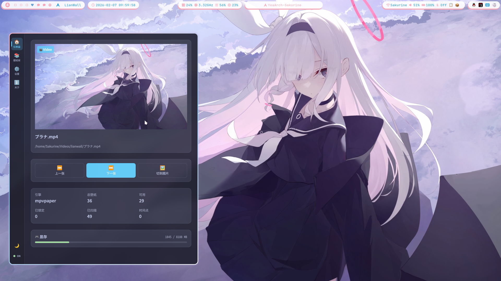
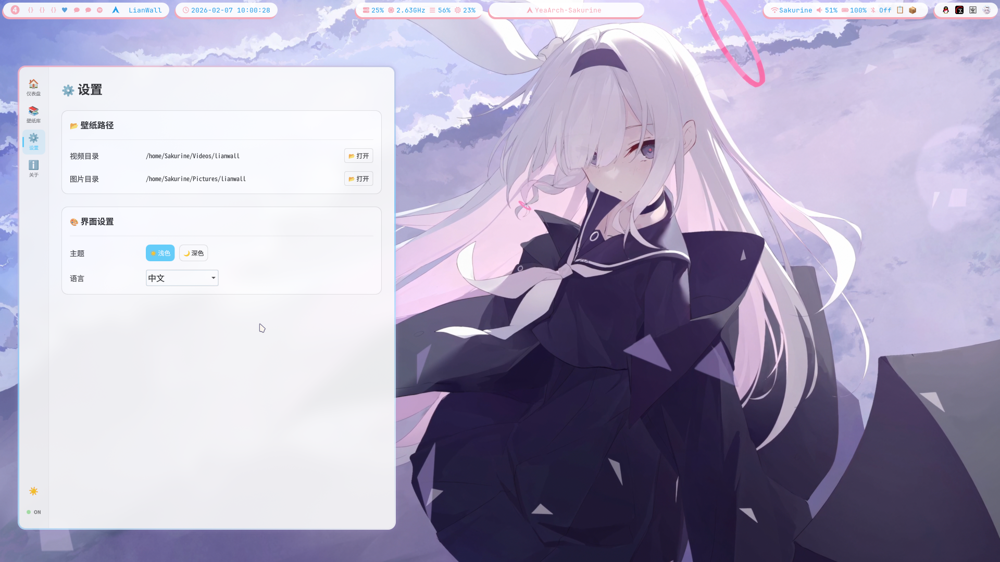
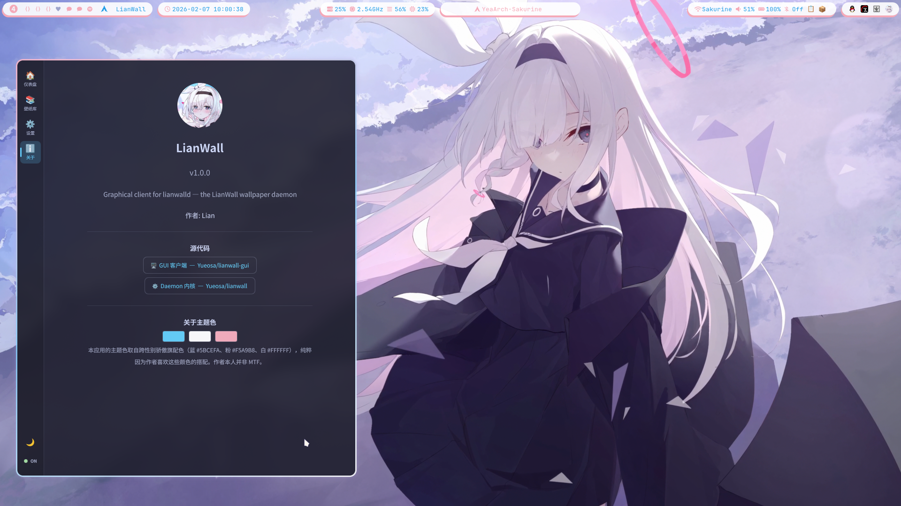

<div align="center">

# 🖼️ LianWall GUI

Qt6/QML 图形前端 — [lianwall](https://github.com/Yueosa/lianwall) 动态壁纸管理器的控制面板

[](https://github.com/Yueosa/lianwall-gui/releases)
[](LICENSE)
[](https://wayland.freedesktop.org/)
[](https://www.qt.io/)

</div>

> **lianwalld 守护进程的图形化客户端** 🎯
> - 通过 **Unix Socket** 直连 daemon，实时事件驱动
> - **正在播放** — 当前壁纸、轮换控制、引擎与显存状态
> - **壁纸库** — 搜索、时间/使用排序、收藏与缩略图
> - **引擎与自动化** — 内置/外部引擎配置、运行诊断与真实Hook规则
> - **设置** — 主题与语言、显存测试、打开服务日志目录
> - **系统托盘** — 后台驻留，关闭窗口 ≠ 退出
> - **中/英双语** — 运行时切换，即时生效

**关于版本更新日志，请查看 [CHANGELOG](./CHANGELOG.md)**

---

## 2.0 界面

GUI 配套 lianwalld 6.0.0。顶部导航包含正在播放、壁纸库、引擎、自动化和设置。默认窗口为 1080 × 640，尺寸可随合成器调整。首页集中显示预览、轮换操作和整卡显存读数。下方旧版截图仅供历史参考。

壁纸库支持同时浏览图片/视频、名称或目录搜索、修改时间排序，以及新daemon提供的收藏、首次发现/最近使用/成功切换次数/驻留时长排序。收藏与排除轮换相互独立；收藏必须收到保存回执后才更新，失败保留原值。资料由daemon保存到XDG数据目录，清理GUI缩略图不会丢失。文件移动/重命名视为新条目，不自动迁移原资料；统计从启用后开始，驻留时长并非观看时长。

旧daemon缺少`GetLibrary`时仍可浏览/控制壁纸，收藏与统计功能不可用并显示原因。引擎页区分配置偏好与实际后端/解码器、准备状态、回退和错误；Hook页读取真实规则、重载和打开配置。设置输入支持Enter提交、Esc取消和保存错误提示。

显存测试已接入真实API，可测试未保存命令并查看读数、输出和错误；测试不改变保存配置或监控状态。日志设置提供打开目录入口，命令行可通过 `lianwall logs` 读取最近记录。

已补齐外部引擎参数、mpv IPC路径、内置过渡帧率、启动模式和算法参数。参数编辑器一行对应一个argv元素，空格、引号、空参数和中文按原样保存，不使用shell拆词。图片外部动画通过awww参数配置；外部mpvpaper淡入时长固定0.4秒，内置动画才使用时长与帧率选项。启动模式不直接切换当前会话。

引擎页根据daemon报告的可执行文件发现结果，禁用未安装的外部后端并显示提示；此检测不代表设备和播放兼容性验证。内置视频需要明确的单个目标输出，软解与硬解都遵守这一要求。

桌面菜单通过`lianwall-gui --show`打开窗口；直接运行默认进入托盘。安装将PNG图标放在`share/pixmaps`，许可证放在`share/licenses/lianwall-gui`。

英语翻译目录已补齐，切换语言同时更新QML与托盘，并使用系统Qt翻译（安装时可用）本地化标准控件。布局为英语标签保留空间。输入框显示服务确认后的规范化值，算法参数保留小数。`daemon.socket_path`/`pid_path`仍通过配置文件或CLI调整，避免在GUI中把当前连接与下次启动路径混淆；算法策略目前只有一种，不提供无意义选择。

Hook编辑/运行历史与真实服务完整交互验收仍在推进，不能将当前界面视作所有功能完成。默认启动仍为后台托盘；`lianwall-gui --show`可直接打开主窗口。

## 📸 1.6 界面预览

| 仪表盘 | 壁纸库 |
|:------:|:------:|
|  |  |

| 设置 | 关于 |
|:----:|:----:|
|  |  |

---

## 📦 安装

### Arch Linux (AUR)

```bash
# 使用 AUR helper
paru -S lianwall-gui
# 或
yay -S lianwall-gui
```

### 手动编译

```bash
git clone https://github.com/Yueosa/lianwall-gui.git
cd lianwall-gui

cmake -B build -DCMAKE_BUILD_TYPE=Release
cmake --build build

# 安装（可选）
sudo cmake --install build
```

### 依赖

#### 运行依赖

| 包 | 说明 |
|----|------|
| Qt 6 (Core, Gui, Widgets, Quick, QuickControls2, Network) | GUI 框架；当前本机构建二进制要求Qt 6.12 |
| ffmpeg | 视频缩略图提取 |
| [lianwall](https://github.com/Yueosa/lianwall) ≥ 5.5.1 | 守护进程 (lianwalld) |

#### 编译依赖

| 包 | 说明 |
|----|------|
| CMake ≥ 3.16 | 构建系统 |
| Qt6 ≥ 6.10 开发包 | 含 LinguistTools；过滤器使用Qt 6.10 API |
| C++17 编译器 | GCC ≥ 9 / Clang ≥ 10 |

---

## 🚀 使用

```bash
# 后台托盘启动
lianwall-gui

# 启动并显示主窗口
lianwall-gui --show

# 或从编译目录
./build/lianwall-gui
```

启动后 GUI 会自动连接 `lianwalld` 守护进程。如果 daemon 未运行，会自动查找并拉起（搜索顺序：`/usr/bin/lianwalld` → `~/.local/bin/lianwalld` → 同目录）。

---

## 🏠 界面

| 页面 | 功能 |
|------|------|
| **正在播放** | 当前媒体预览、轮换与倒计时、引擎/显存/自动化摘要 |
| **壁纸库** | 图片/视频合并浏览、搜索/筛选/排序、收藏、排除轮换、双击播放 |
| **引擎** | 内置/外部后端、输出/解码/动画、外部argv与IPC、实际运行诊断 |
| **自动化** | Hook规则、条件、命令与状态，打开配置、重载与详情 |
| **设置** | 轮换/路径/启动偏好/算法、外观/语言、显存测试、服务日志 |

顶部居中Tab可用Alt+1…5切换；“关于”位于应用菜单。窗口关闭后继续驻留托盘，“退出GUI与服务”才会关闭两者。

---

## 🏗️ 架构

```
lianwall-gui (Qt6/QML)
    │
    ├── DaemonClient ──── Unix Socket ──── lianwalld (Rust)
    │     (QLocalSocket)    JSON V3         (/tmp/lianwall.sock)
    │
    ├── DaemonState ────── 事件订阅 ────── WallpaperChanged
    │                                       ConfigChanged
    │                                       TimeInfo
    │
    ├── ConfigManager ──── GetConfig/SetConfig
    │     (Q_PROPERTY)      + QSettings (本地 GUI 设置)
    │
    └── WallpaperListModel + ThumbnailProvider
          (QAbstractListModel)  (ffmpeg + 磁盘缓存)
```

---

## ⚙️ 配置

### Daemon 配置

通过设置页或 `lianwall config` 命令管理，存储在 `~/.config/lianwall/config.toml`。

### GUI 本地设置

存储在 QSettings 默认位置：

| 设置 | 说明 | 默认值 |
|------|------|--------|
| `app/theme` | 界面主题 (`lian` / `lian-dark`) | `lian` |
| `app/language` | 界面语言 (`zh_CN` / `en`) | `zh_CN` |

---

## 🎨 主题色

提供浅色/深色主题及三种强调色，设置后立即生效：

| 强调色 | 浅色主题 | 深色主题 |
|--------|----------|----------|
| 鸢尾（默认） | `#79558f` | `#d3b4ea` |
| 樱粉 | `#a45f78` | `#f0b3ca` |
| 天空 | `#46758e` | `#a5d1e9` |

---

## 📄 许可证

LianWall License — 详见 [LICENSE](LICENSE) 文件

自由使用、修改、分发，但未经作者同意不得用于商业盈利。

## 👤 作者

**Lian** ([Yueosa](https://github.com/Yueosa))

## 开发回归测试

Qt Test 为可选构建依赖，正常构建无需安装。启用测试后，可使用临时模拟 Unix socket
验证超时、重连、请求匹配、操作状态和图库快照；测试不启动壁纸引擎。
`settings`测试使用离屏Qt Quick真实控件，验证Enter/Esc与焦点、输入验证、小数和规范化目录显示、参数原样传递/失败草稿，以及翻译完整性与占位符。默认三套CTest均在临时目录运行。

```sh
cmake -S . -B build-tests -DLIANWALL_BUILD_TESTS=ON -DCMAKE_BUILD_TYPE=Debug
cmake --build build-tests -j
ctest --test-dir build-tests --output-on-failure
```


首次连接找不到 daemon 时，GUI 会尝试拉起一次；成功连接过之后，断线仅尝试重连，不会自动重启已停止的 daemon。

## 本地设置与缩略图缓存

GUI 设置存放于 `$XDG_CONFIG_HOME/lianwall/gui.conf`（默认 `~/.config/lianwall/gui.conf`）。
自定义 XDG 路径且新文件不存在时，自动原子复制旧 HOME 路径的设置，保留原文件；复制失败则继续使用旧文件并记录警告。
缩略图位于 `$XDG_CACHE_HOME/lianwall/thumbnails`（默认 `~/.cache/lianwall/thumbnails`），设置页显示同一路径。

新版缓存键包含源文件路径、大小与修改/元数据时间；刷新后重新检查源文件，损坏缓存自动重新生成。
同键并发请求共享生成结果，JPEG 原子保存；磁盘写入失败记录警告，仍显示内存中的图片。
新版 `v2_*.jpg` 缓存按最旧写入时间清理，软上限 512 MiB / 4096 项；首次访问、每 64 次访问或间隔 60 秒检查，允许短时超限。
旧 Qt 应用缓存目录暂不自动清理，不删除原始壁纸、权重或用户设置。
测试还覆盖取消等待、运行中视频任务退出及缓存写入失败；大图库滚动观感仍需图形会话实测。

静态引擎配置统一使用 `image_engine.awww_args`；本版 GUI 需与支持该键的 daemon 配套升级，
不再发送旧 `swww_args`。旧 TOML 的备份与迁移由 daemon/core 负责，详见主仓库 README。

### 自定义 daemon socket 与重启

配置了自定义 `daemon.socket_path` 时，以相同路径启动 GUI：

```bash
lianwall-gui --socket /run/user/1000/lianwall.sock
```

默认路径仍为 `/tmp/lianwall.sock`；`--socket` 支持绝对/相对路径与 `~/`，按端点区分 GUI 单实例。
托盘重启先取得 Shutdown 回执，再等待旧 socket 释放（最多 15 秒）后启动新 daemon；启动成功表示进程已发起，连接状态随后确认就绪。
设置查询会合并并丢弃被新事件淘汰的旧快照，断线后重置加载状态；销毁配置对象不会接收迟到回调。
通信请求每帧最多 1 MiB，超过时本地拒绝；响应每帧最多 64 MiB，超过时断线重同步。

本版GUI2.0.1请配套daemon/CLI6.0.0，旧配置键按既有规则迁移。主要维护作者本机Linux/Hyprland，其他桌面环境未经完整验证；内置引擎支持范围与系统库要求见daemon6.0.0发行说明。

开发或便携运行时可用`lianwall-gui --show --daemon-executable /absolute/path/to/lianwalld`固定自动启动及菜单重启所使用的daemon；也支持`LIANWALL_DAEMON_EXECUTABLE`环境变量。指定路径无效时失败，不静默回退到系统旧版本。此选项不替换已经运行的服务，升级预览前需先停止旧服务。SIGTERM/SIGINT仅退出GUI，壁纸服务继续运行；菜单“退出GUI与服务”才显式停止两者。
